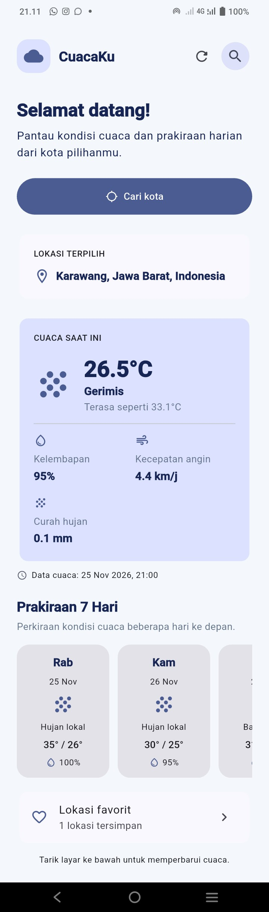
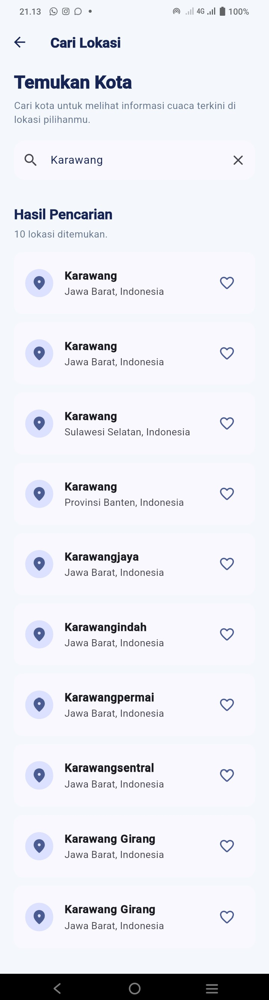

# 🌤️ CuacaKu — Aplikasi Informasi Cuaca

## Identitas Mahasiswa

| Keterangan | Identitas |
|---|---|
| Nama Lengkap | Ian Jullian Sutrisno |
| NIM | H1D024039 |
| Shift Awal | I |
| Shift Akhir | C |
| Mata Praktikum | Responsi Flutter - Praktikum Pemrograman Mobile |

---

CuacaKu merupakan aplikasi mobile berbasis Flutter yang digunakan untuk melihat informasi cuaca terkini dan prakiraan cuaca selama tujuh hari berdasarkan lokasi yang dipilih pengguna.

Aplikasi ini dikembangkan menggunakan REST API dari Open-Meteo dengan menerapkan arsitektur Model-View-ViewModel (MVVM), pengelolaan state menggunakan Provider, serta penyimpanan lokasi favorit secara lokal menggunakan SharedPreferences.

## 📱 Screenshot Aplikasi

### 1. Home / Weather Screen

Menampilkan informasi cuaca terkini berdasarkan kota yang dipilih, meliputi suhu, kondisi cuaca, suhu yang dirasakan, kelembapan udara, kecepatan angin, curah hujan, dan prakiraan cuaca tujuh hari.



### 2. Search / Location Screen

Menyediakan fitur pencarian kota menggunakan Geocoding API Open-Meteo, menampilkan hasil pencarian lokasi, serta memungkinkan pengguna menyimpan dan menghapus lokasi favorit.



## ✨ Fitur Aplikasi

- **Informasi Cuaca Terkini:** Menampilkan suhu, kondisi cuaca, suhu yang dirasakan, kelembapan, kecepatan angin, dan curah hujan.
- **Prakiraan Cuaca 7 Hari:** Menampilkan perkiraan suhu maksimum, suhu minimum, kondisi cuaca, dan peluang hujan.
- **Pencarian Lokasi:** Mencari kota berdasarkan nama menggunakan Open-Meteo Geocoding API.
- **Lokasi Favorit:** Menambahkan dan menghapus kota dari daftar favorit.
- **Penyimpanan Lokal:** Mempertahankan daftar lokasi favorit menggunakan SharedPreferences.
- **Refresh Cuaca:** Memperbarui informasi cuaca melalui tombol refresh maupun pull-to-refresh.
- **Penanganan Kondisi Aplikasi:** Menangani loading, hasil pencarian kosong, dan kegagalan permintaan API.

## 🛠️ Teknologi yang Digunakan

| Teknologi | Kegunaan |
|---|---|
| Flutter | Framework pengembangan aplikasi |
| Dart | Bahasa pemrograman |
| Material Design 3 | Standar desain antarmuka |
| Provider | State management |
| HTTP | Komunikasi REST API |
| SharedPreferences | Penyimpanan lokasi favorit |
| Open-Meteo | Penyedia data cuaca dan geocoding |

## 🏗️ Arsitektur Aplikasi

Aplikasi CuacaKu menerapkan arsitektur **Model-View-ViewModel (MVVM)** untuk memisahkan pengelolaan data, logika aplikasi, dan antarmuka pengguna.

### Pembagian Komponen

**1. Model**

Model bertanggung jawab merepresentasikan dan mengolah data JSON dari API menjadi objek Dart.

File:
- `location_model.dart`
- `weather_model.dart`

**2. View**

View bertanggung jawab menampilkan antarmuka aplikasi dan menerima interaksi pengguna.

File:
- `home_screen.dart`
- `search_screen.dart`
- `forecast_card.dart`

**3. ViewModel**

ViewModel mengelola state aplikasi, menghubungkan data dari Service dengan View, serta memperbarui tampilan menggunakan ChangeNotifier.

File:
- `weather_viewmodel.dart`
- `location_viewmodel.dart`

**4. Service**

Service bertanggung jawab menangani komunikasi dengan API dan penyimpanan data lokal.

File:
- `weather_service.dart`
- `location_service.dart`
- `storage_service.dart`
- `api_exception.dart`

**5. Core**

Core menyimpan konfigurasi yang digunakan bersama oleh aplikasi, termasuk Theme dan pemetaan kondisi cuaca berdasarkan kode WMO.

## 📂 Struktur Folder Proyek

```text
lib/
├── main.dart
│
├── core/
│   ├── constants/
│   │   └── weather_condition.dart
│   └── theme/
│       └── app_theme.dart
│
├── models/
│   ├── location_model.dart
│   └── weather_model.dart
│
├── services/
│   ├── api_exception.dart
│   ├── location_service.dart
│   ├── storage_service.dart
│   └── weather_service.dart
│
├── viewmodels/
│   ├── location_viewmodel.dart
│   └── weather_viewmodel.dart
│
├── views/
│   ├── home/
│   │   └── home_screen.dart
│   └── search/
│       └── search_screen.dart
│
└── widgets/
    └── forecast_card.dart

test/
├── widget_test.dart
├── weather_condition_test.dart
└── forecast_card_test.dart
```

## 🌐 Implementasi Open-Meteo API

CuacaKu menggunakan dua layanan REST API dari Open-Meteo.

### Metode Request dan Pengolahan Respons

Kedua layanan API diakses menggunakan metode HTTP GET dengan package `http`.

Respons API diterima dalam format JSON, kemudian diolah menggunakan `jsonDecode()` dan dikonversi menjadi objek Dart melalui factory constructor `fromJson()` pada model data.

Proses komunikasi API dan pengolahan respons dilakukan pada folder `services/`, sedangkan pengelolaan data dilakukan melalui folder `models/`.

### 1. Weather Forecast API

Endpoint:

`https://api.open-meteo.com/v1/forecast`

Digunakan untuk mengambil informasi cuaca berdasarkan koordinat latitude dan longitude dari lokasi yang dipilih.

Parameter yang digunakan:

| Parameter | Keterangan |
|---|---|
| latitude | Koordinat lintang lokasi |
| longitude | Koordinat bujur lokasi |
| current | Informasi cuaca terkini |
| daily | Prakiraan cuaca harian |
| timezone | Menggunakan nilai `auto` |
| forecast_days | Mengambil prakiraan 7 hari |

Data yang digunakan:

| Informasi | Field API |
|---|---|
| Suhu saat ini | `current.temperature_2m` |
| Kelembapan | `current.relative_humidity_2m` |
| Suhu yang dirasakan | `current.apparent_temperature` |
| Curah hujan | `current.precipitation` |
| Kode cuaca | `current.weather_code` |
| Kecepatan angin | `current.wind_speed_10m` |
| Suhu maksimum | `daily.temperature_2m_max` |
| Suhu minimum | `daily.temperature_2m_min` |
| Peluang hujan | `daily.precipitation_probability_max` |
| Kode cuaca harian | `daily.weather_code` |

### 2. Geocoding API

Endpoint:

`https://geocoding-api.open-meteo.com/v1/search`

Digunakan untuk mencari lokasi berdasarkan nama kota.

Parameter yang digunakan:

| Parameter | Nilai |
|---|---|
| name | Nama kota yang dicari |
| count | 10 |
| language | id |
| format | json |

Hasil pencarian digunakan untuk memperoleh nama lokasi, negara, wilayah administratif, latitude, dan longitude.

Koordinat lokasi yang dipilih selanjutnya dikirimkan ke Weather Forecast API untuk memperoleh informasi cuaca.

Dokumentasi API:
- [Open-Meteo Weather Forecast API](https://open-meteo.com/en/docs)
- [Open-Meteo Geocoding API](https://open-meteo.com/en/docs/geocoding-api)

## 💾 Penyimpanan Data Lokal

Aplikasi menggunakan SharedPreferences untuk menyimpan daftar lokasi favorit pengguna.

Data lokasi dikonversi menjadi format JSON sebelum disimpan sebagai string list pada penyimpanan lokal perangkat.

Dengan demikian, daftar lokasi favorit tetap tersedia ketika aplikasi ditutup dan dibuka kembali.

## 🔄 Pengelolaan State

Pengelolaan state menggunakan Provider dengan ChangeNotifier.

- `WeatherViewModel` mengelola data cuaca, lokasi terpilih, loading, dan pesan error.
- `LocationViewModel` mengelola proses pencarian kota, hasil pencarian, serta lokasi favorit.

Perubahan state akan memicu pembaruan tampilan melalui mekanisme Provider sehingga View tidak perlu menangani proses pengambilan data API secara langsung.

## 🚀 Cara Menjalankan Aplikasi

### Persyaratan

- Flutter SDK
- Dart SDK
- Visual Studio Code atau IDE Flutter lainnya
- Perangkat Android atau browser
- Koneksi internet

### Instalasi

1. Clone repository:

```bash
git clone https://github.com/IanJullian/H1D024039-Responsi-Flutter.git
```

2. Masuk ke folder proyek:

```bash
cd H1D024039-Responsi-Flutter
```

3. Instal dependencies:

```bash
flutter pub get
```

4. Jalankan aplikasi:

```bash
flutter run
```

## 🧪 Pengujian Aplikasi

Pengujian dilakukan menggunakan Flutter Test dan Flutter Analyze.

Perintah pemeriksaan:

```bash
dart format --output=none --set-exit-if-changed lib test
```

```bash
flutter analyze
```

```bash
flutter test
```

Hasil pengujian terakhir:

- Dart Formatter: 17 file, tidak ditemukan perubahan format.
- Flutter Analyze: No issues found.
- Flutter Test: 10 pengujian berhasil.

Pengujian juga dilakukan secara langsung pada perangkat Android untuk memastikan pencarian kota, pengambilan data cuaca dari API, pemilihan lokasi, refresh cuaca, dan penyimpanan lokasi favorit berjalan sesuai fungsinya.

## 🎓 Tujuan Pengembangan

Aplikasi CuacaKu dikembangkan sebagai pemenuhan tugas Responsi Flutter dengan menerapkan konsep pengembangan aplikasi mobile, komunikasi REST API, pengelolaan state, local storage, dan arsitektur MVVM.

---

**CuacaKu — Informasi Cuaca dalam Genggaman.** 🌤️
